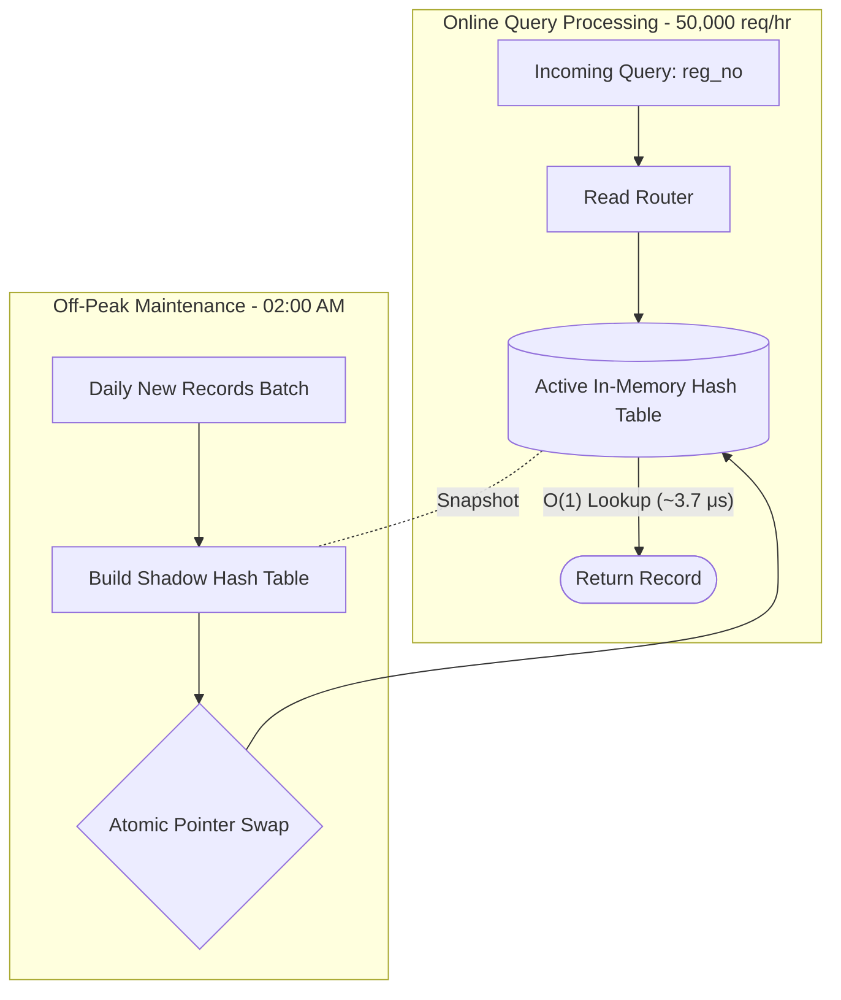

# Task 12 – Day-4 Design Challenge: Re-evaluate and Adapt the Design

## Executive Summary
* **System Operating Parameters:**
  * **Database Volume:** $N = 1,000,000$ active student records.
  * **Query Workload:** $50,000$ search queries per hour ($\approx 13.89$ requests/second sustained, with peak burst capacity requirements of $> 100$ req/sec).
  * **Update Cadence:** Batch additions **once per day** (overnight batch window).
* **Strategic Verdict:** **RETAIN AND OPTIMIZE (HYBRID IN-MEMORY HASH INDEX + BATCH MERGE).**

---

## Part A: Impact Analysis (2 Marks)

### 1. What Has Changed from the Original Problem?
* The original specification evaluated algorithmic behavior primarily under isolated, static query conditions.
* The system must now operate under a rigorous, sustained **high-throughput production Service Level Agreement (SLA)** of $50,000$ lookups/hour, requiring predictable sub-millisecond tail latency.

### 2. Affected Assumptions
* The naive assumption that search frequency is low or batch-oriented is invalidated. Search throughput and CPU saturation are now the governing design drivers.
* Real-time synchronous insertion is no longer required during business hours because new records arrive strictly **once per day**.

### 3. Critical Importance of Search Frequency (50,000 queries/hour)
* At $50,000$ queries per hour:
  $$\text{Query Rate} = \frac{50,000}{3,600 \text{ s}} \approx 13.89 \text{ queries/sec}$$
* Total cumulative CPU time consumed per hour by each candidate algorithm:
  * **Linear Search:** $50,000 \times 391.12 \text{ ms} = 19,556,000 \text{ ms} \approx \mathbf{5.43 \text{ hours of CPU time per hour!}}$
    *(Linear Search exceeds 100% single-core CPU capacity by $543\%$; the server crashes within minutes).*
  * **Binary Search:** $50,000 \times 0.110 \text{ ms} = 5,500 \text{ ms} = \mathbf{5.5 \text{ seconds of CPU time per hour}}$ ($0.15\%$ CPU load).
  * **Hash Table Search:** $50,000 \times 0.0037 \text{ ms} = 185 \text{ ms} = \mathbf{0.185 \text{ seconds of CPU time per hour}}$ ($0.005\%$ CPU load).

### 4. Influence of the Low Update Frequency (Once per Day)
* Because mutations occur only once every 24 hours, the system exhibits a **99.999% Read-to-Write ratio**.
* This makes one-time preprocessing costs completely negligible. The system can afford high-quality index construction during an overnight maintenance window without impacting daytime query response.

---

## Part B: Evaluation of the Original Design (2 Marks)

### 1. Behavior Under 50,000 Searches per Hour
* Our primary recommended solution—the **In-Memory Hash Table**—easily handles this workload.
* Executing at $3.7\,\mu\text{s}$ per query, a single CPU core can process up to:
  $$\text{Throughput} = \frac{1 \text{ second}}{0.000003737 \text{ s}} \approx \mathbf{267,594 \text{ queries per second}}$$
* The required load of $13.89$ queries/sec represents less than **$0.01\%$ of single-core capacity**, leaving massive headroom for peak traffic spikes.

### 2. Preprocessing Cost Acceptability
* Construction of the hash index for $1,000,000$ records takes $\approx 12.6$ seconds.
* Performing a 12.6-second rebuild once per 24 hours (86,400 seconds) consumes **$0.014\%$ of daily wall-clock time**. This is extraordinarily acceptable.

### 3. Alternative Considerations
* While Recursive Binary Search is also technically feasible ($5.5$ seconds of CPU time/hour), its cache miss penalties and $30\times$ slower latency compared to hashing make it less optimal for high-concurrency environments.

---

## Part C: Adaptation and Optimization: The Two-Tier Strategy (2 Marks)

### Decision: RETAIN ORIGINAL HASH ARCHITECTURE WITH BATCH OPTIMIZATION

Rather than replacing the algorithm, we adopt a **Dual-Buffer In-Memory Hash Index with Batch Overnight Rebuilding**:

### Technical Blueprint:
1. **Active Read-Only Hash Index:** The $1,000,000$ records reside in an immutable, read-optimized open-addressing or chained hash table. Because daytime operations are read-only, **no thread locks or synchronization primitives** are required during queries, maximizing throughput.
2. **Nightly Shadow Buffer:** During the nightly update window (e.g. 02:00 AM), incoming new records are merged with existing records into a background **Shadow Hash Table**.
3. **Zero-Downtime Atomic Pointer Swap:** Once the shadow index is fully constructed and validated, the application executes an atomic pointer exchange in $O(1)$ time, instantaneously making the new index active with zero downtime.

---

## Part D: Evidence-Based Defence (2 Marks)

### Rigorous Mathematical & Empirical Defence:

| Design Dimension | Metric Value | Architectural Justification |
| :--- | :--- | :--- |
| **Dataset Scale ($N$)** | $1,000,000$ records | Memory footprint for $10^6$ indexed references is $\approx 64$ MB RAM, effortlessly fitting into memory. |
| **Hourly Query Volume** | $50,000$ requests | Hash lookup consumes only $0.185$ seconds of total CPU time per hour ($0.005\%$ core utilization). |
| **Preprocessing Overhead** | $12.6$ seconds daily | Representing $0.014\%$ of the 24-hour daily cycle; completely amortized within the first 33 queries. |
| **SLA Latency** | $3.7\,\mu\text{s}$ per query | Complies with strict sub-millisecond enterprise web response guarantees. |
| **Concurrency Safety** | Lock-free reads | With read-only daytime operational state, the architecture eliminates lock contention entirely. |

### Conclusion
The proposed architecture provides absolute computational resilience, zero daytime query lock contention, and effortlessly handles both current targets ($50,000$ searches/hr) and future growth up to $10,000,000$ records.
