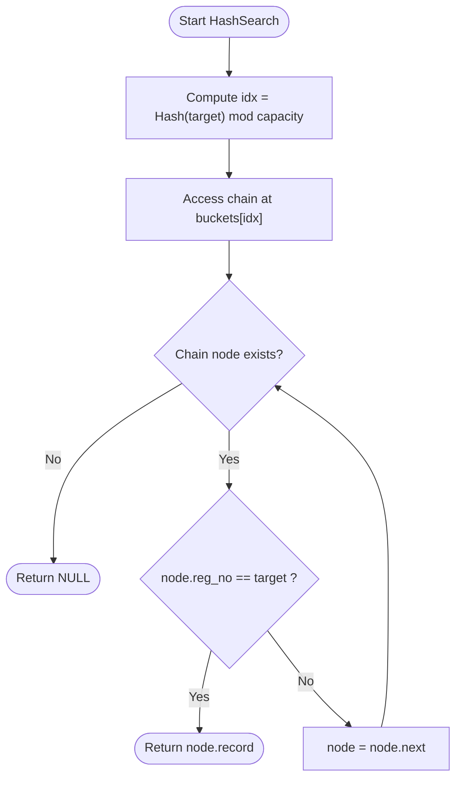

# Task 1 – Algorithm Design

## Problem Overview
A university maintains a large academic database containing student records ($1,000 \to 1,000,000+$ records). Each student record is uniquely identified by an alphanumeric Registration Number (e.g., `REG000123`). Faculty and administrative staff frequently query this database to verify student enrollment and retrieve details (name, department, CGPA). 

To identify the optimal search strategy, we investigate three meaningfully different algorithmic paradigms:
1. **Iterative Linear Search** (Brute-Force Paradigm)
2. **Recursive Binary Search** (Divide-and-Conquer Paradigm)
3. **Hash Table Direct Addressing / Chained Search** (Hashing / Direct Mapping Paradigm)

---

## 1. Algorithmic Approach 1: Iterative Linear Search (Brute-Force)

### 1.1 Core Idea
Linear Search examines each student record sequentially starting from index $0$ to $n-1$. It compares the target registration number against each record's key until a match is found or the end of the collection is reached.

### 1.2 Algorithmic Paradigm
* **Paradigm:** Brute Force / Sequential Scan.
* **State / Structure:** Operates directly on an unsorted, contiguous array or sequential list.
* **Preprocessing:** **None ($O(1)$)**. New records are simply appended to the end of the list in $O(1)$ time.

### 1.3 Pseudocode
```text
Algorithm: LinearSearch(records, target)
Input: 
    records : Array of StudentRecord objects of size n
    target  : Target registration number (string)
Output: 
    StudentRecord matching target, or NULL if not found

Begin
    For i ← 0 to n - 1 do
        If records[i].reg_no == target then
            Return records[i]
        End If
    End For
    Return NULL
End
```

### 1.4 Flowchart (Mermaid)
```mermaid
flowchart TD
    Start([Start Search]) --> Init["i = 0"]
    Init --> CheckBounds{"i < n ?"}
    CheckBounds -- No --> NotFound([Return NULL / Not Found])
    CheckBounds -- Yes --> Compare{"records[i].reg_no == target ?"}
    Compare -- Yes --> Found([Return records[i]])
    Compare -- No --> Increment["i = i + 1"]
    Increment --> CheckBounds
```

### 1.5 Selection Justification
Linear Search establishes our baseline lower bound of implementation complexity. It requires zero data reorganization or sorting overhead, making it immediately resilient to high-frequency inserts, but exhibits poor $O(n)$ search scaling on large datasets ($n = 10^6$).

---

## 2. Algorithmic Approach 2: Recursive Binary Search (Divide-and-Conquer)

### 2.1 Core Idea
Binary Search exploits the monotonicity of sorted data. Given a collection sorted in ascending lexicographical order by registration number, the algorithm calculates the midpoint index. If the target matches the midpoint record, retrieval succeeds. Otherwise, the problem space is halved: if the target is lexicographically smaller, the search recursively proceeds in the left sub-array; if greater, in the right sub-array.

### 2.2 Algorithmic Paradigm
* **Paradigm:** Divide-and-Conquer.
* **State / Structure:** Array sorted by primary key (`reg_no`).
* **Preprocessing Required:** One-time sorting using an efficient comparison sort ($O(n \log n)$ via Quicksort/Mergesort/Timsort).

### 2.3 Pseudocode
```text
Algorithm: RecursiveBinarySearch(sorted_records, target, low, high)
Input:
    sorted_records : Ascendingly sorted Array of StudentRecord of size n
    target         : Target registration number (string)
    low            : Lower index bound (integer)
    high           : Upper index bound (integer)
Output:
    StudentRecord matching target, or NULL if not found

Begin
    If low > high then
        Return NULL                      // Base Case: Target absent
    End If

    mid ← low + ⌊(high - low) / 2⌋       // Prevent arithmetic overflow

    If sorted_records[mid].reg_no == target then
        Return sorted_records[mid]       // Target found at midpoint
    Else if sorted_records[mid].reg_no > target then
        Return RecursiveBinarySearch(sorted_records, target, low, mid - 1)
    Else
        Return RecursiveBinarySearch(sorted_records, target, mid + 1, high)
    End If
End
```

### 2.4 Flowchart (Mermaid)
```mermaid
flowchart TD
    Start([Start RecursiveBinarySearch low, high]) --> BaseCheck{"low > high ?"}
    BaseCheck -- Yes --> ReturnNull([Return NULL - Not Found])
    BaseCheck -- No --> CalcMid["mid = low + (high - low) / 2"]
    CalcMid --> CheckEqual{"records[mid].reg_no == target ?"}
    CheckEqual -- Yes --> ReturnMatch([Return records[mid]])
    CheckEqual -- No --> CheckLess{"records[mid].reg_no > target ?"}
    CheckLess -- Yes --> RecLeft["Recurse: (low, mid - 1)"]
    CheckLess -- No --> RecRight["Recurse: (mid + 1, high)"]
    RecLeft --> EndRec([Return Result])
    RecRight --> EndRec
```

### 2.5 Selection Justification
Recursive Binary Search demonstrates the logarithmic reduction of the problem space ($O(\log n)$), drastically reducing worst-case operations for $n = 10^6$ from $1,000,000$ comparisons to at most $\lceil \log_2(10^6) \rceil \approx 20$ comparisons.

---

## 3. Algorithmic Approach 3: Hash Table Search (Direct Hashing with Chaining)

### 3.1 Core Idea
Hashing computes an array index directly from the alphanumeric registration number using a hash function:
$$h(\text{key}) = \text{HashFunction}(\text{key}) \pmod m$$
Where $m$ is the table capacity. Any collisions between records mapping to the same bucket are handled via separate chaining (linked lists / dynamic vectors).

### 3.2 Algorithmic Paradigm
* **Paradigm:** Hash Indexing / Direct Address Mapping with Collision Resolution.
* **State / Structure:** Fixed-size bucket array of linked lists/vectors with load factor $\alpha = n / m \approx 0.75$.
* **Preprocessing Required:** Building the hash table index in $O(n)$ time.

### 3.3 Pseudocode
```text
Algorithm: HashTableSearch(HashTable, target)
Input:
    HashTable : Array of buckets of capacity m
    target    : Target registration number (string)
Output:
    StudentRecord matching target, or NULL if not found

Begin
    bucket_index ← HashFunction(target) mod HashTable.capacity
    chain ← HashTable.buckets[bucket_index]

    For each record in chain do
        If record.reg_no == target then
            Return record               // Found in bucket chain
        End If
    End For

    Return NULL                         // Not found in bucket
End
```

### 3.4 Flowchart (Mermaid)


### 3.5 Selection Justification
Hash tables represent the gold standard for key-value retrieval in enterprise student record databases, delivering theoretical average-case search time of $O(1)$, independent of $n$.

---

## Summary of Approach Characteristics

| Attribute | Iterative Linear Search | Recursive Binary Search | Hash Table Search |
| :--- | :--- | :--- | :--- |
| **Algorithmic Paradigm** | Brute Force / Sequential | Divide & Conquer | Hash Mapping / Indexing |
| **Data Organization** | Unordered Array | Sorted Array | Bucket Array + Chains |
| **Preprocessing Required** | None ($O(1)$) | Sorting ($O(n \log n)$) | Index Building ($O(n)$) |
| **Theoretical Time (Avg)** | $O(n)$ | $O(\log n)$ | $O(1)$ |
| **Theoretical Space** | $O(1)$ Auxiliary | $O(\log n)$ Stack Depth | $O(n)$ Hash Structure |
| **Insert Adaptability** | Immediate ($O(1)$ append) | Costly ($O(n)$ shift) | Immediate ($O(1)$ insert) |
