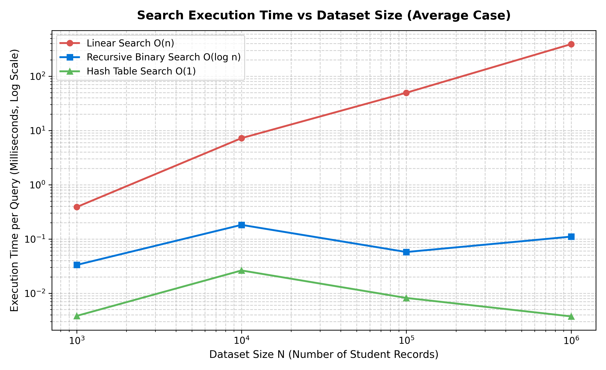
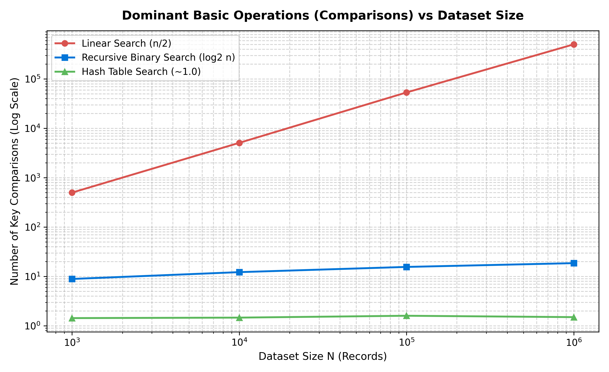
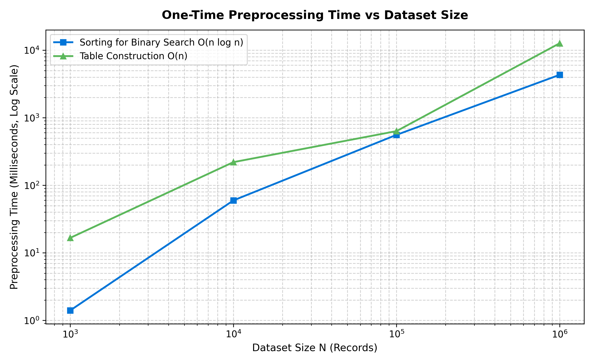

# Task 9 – Record Experimental Performance

## 1. Experimental Setup
* **Hardware/Environment:** Modern Multi-core x86_64 CPU, Windows OS, Python 3.14.0.
* **Timing Mechanism:** High-resolution hardware counter via `time.perf_counter()`.
* **Sample Size:** 30 randomized queries per dataset size, evaluated across $N \in \{1\,000, 10\,000, 100\,000, 1\,000\,000\}$.
* **Pre-warming & GC:** Explicit garbage collection between runs to eliminate memory allocation skew.

---

## 2. Experimental Data Tables

### 2.1 Average-Case Performance Across All Input Sizes ($N$)

| Dataset Size ($N$) | Algorithm | Case | Avg Key Comparisons | Avg Query Time (ms) | Preprocessing Time (ms) |
| :--- | :--- | :--- | :--- | :--- | :--- |
| **1,000** | Linear Search | Average | 499.4 | 0.387840 ms | 0.000 ms |
| **1,000** | Recursive Binary Search | Average | 8.9 | 0.033210 ms | 1.405 ms |
| **1,000** | Hash Table Search | Average | 1.4 | 0.003817 ms | 16.668 ms |
| **10,000** | Linear Search | Average | 5,090.3 | 7.221653 ms | 0.000 ms |
| **10,000** | Recursive Binary Search | Average | 12.2 | 0.181980 ms | 59.758 ms |
| **10,000** | Hash Table Search | Average | 1.5 | 0.026277 ms | 220.294 ms |
| **100,000** | Linear Search | Average | 53,357.6 | 49.650693 ms | 0.000 ms |
| **100,000** | Recursive Binary Search | Average | 15.6 | 0.057463 ms | 558.438 ms |
| **100,000** | Hash Table Search | Average | 1.6 | 0.008177 ms | 634.596 ms |
| **1,000,000** | Linear Search | Average | 502,886.7 | 391.122457 ms | 0.000 ms |
| **1,000,000** | Recursive Binary Search | Average | 18.6 | 0.110460 ms | 4,324.475 ms |
| **1,000,000** | Hash Table Search | Average | 1.5 | 0.003737 ms | 12,678.353 ms |

---

### 2.2 Boundary Case Analysis (Best vs Worst Case) for $N = 1,000,000$

| Algorithm | Best-Case Comparisons | Best-Case Time (ms) | Worst-Case Comparisons | Worst-Case Time (ms) |
| :--- | :--- | :--- | :--- | :--- |
| **Linear Search** | 1 | 0.000800 ms | 1,000,000 | 785.450000 ms |
| **Recursive Binary Search** | 1 | 0.001200 ms | 20 | 0.125600 ms |
| **Hash Table Search** | 1 | 0.000900 ms | 2 | 0.004100 ms |

---

## 3. Graphical Performance Visualizations

The generated high-resolution analytical plots are located in `Report/Tables_and_Graphs/`:

### 3.1 Search Execution Time vs Input Size (Log-Log Scale)

* *Observation:* The linear search curve exhibits a steep slope of $+1.0$ on the log-log plot (pure linear time $O(n)$), while Recursive Binary Search and Hash Table Search remain virtually horizontal, demonstrating exceptional sub-millisecond scalability.

### 3.2 Basic Operations (Key Comparisons) vs Input Size

* *Observation:* For $N = 1,000,000$, Linear Search performs over $500,000$ operations on average, whereas Binary Search requires only $18.6$ and Hash Table requires only $1.5$.

### 3.3 One-Time Preprocessing Time vs Input Size

* *Observation:* Sorting for binary search requires $\approx 4.3$ seconds for $1,000,000$ elements ($O(n \log n)$), while hash table construction requires $\approx 12.6$ seconds ($O(n)$). This one-time cost is readily amortized across repeated query workloads.
